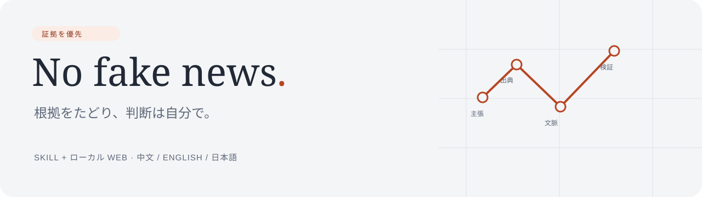
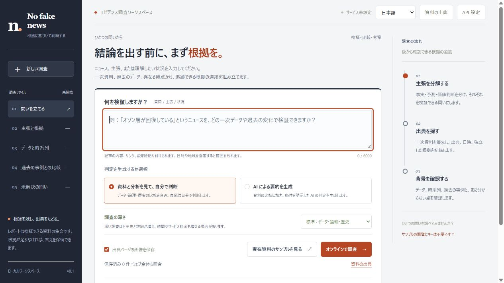
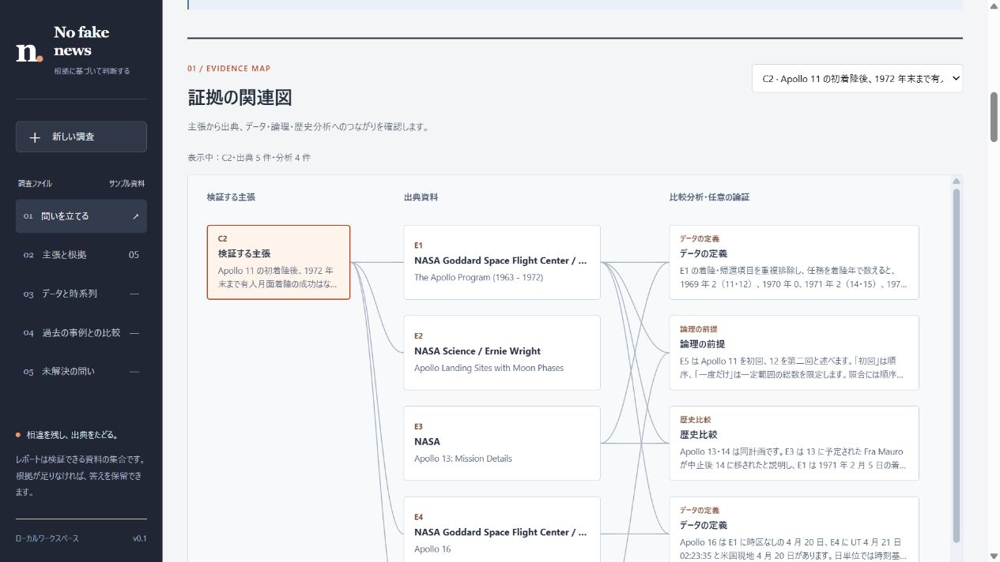
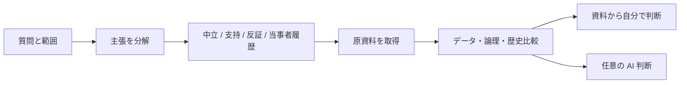

<p align="center"></p>
<p align="center"><a href="https://github.com/mengyihh233/No-fake-news/actions/workflows/ci.yml"></a> · <a href="LICENSE">MIT</a> · Python 3.11+ · ビルド不要</p>
<p align="center"><a href="README.md">English</a> · <a href="README.zh-CN.md">简体中文</a> · <strong>日本語</strong></p>

# No fake news

主張、ニュース、質問、状況を、検証可能な証拠資料にまとめます。原資料、データ、論理の前提、歴史的事例を比較し、AI に判断を追加させるかを選べます。

自分の AI・検索 API を使う **ローカル Web アプリ**と、AI ホストに導入する **`tell-me-truth` Skill** を提供します。ブランドは **No fake news**、互換性のため Skill ID は `tell-me-truth` のままです。

> 公正さは検証可能な手順で追求します。絶対的な客観性を保証せず、出典、検索範囲、前提、不確実性を示します。



## 機能

| 機能 | 動作 |
| --- | --- |
| 判断の有無を選択 | 資料モードはデータ・論理・歴史比較を保持し、AI 要約は条件付き判断と明示的な論証を追加します。 |
| 深さを調整 | 簡潔 / 標準 / 詳細で実際の予算が変わります。判断の有無とは独立しています。 |
| 根拠を追跡 | 主張と出典の関連、原文抜粋、情報源の系統、出典付きグラフと表、年表、歴史比較、未解決の問い。 |
| 情報源を保存 | 最大六つのサイト・資料 URL を保存。広い検索に追加するか、指定ドメインに限定できます。 |
| 許可されたアクセス | 正確な HTTPS オリジンに限定した HTTP Basic、Cookie、Bearer トークンをセッション中に使用。 |
| 持ち運べる資料 | JSON 読込・書出し、ローカル画像を埋め込む単独 HTML 書出し。 |
| 三言語 | 简体中文 / English / 日本語で UI、新規生成文、書出しラベル、CLI、Skill、文書を提供。引用は原言語のまま。 |
| 自分のモデル | OpenAI 互換 Chat Completions と、別途 Tavily または Brave の検索アカウント。 |

配置・証拠図・参考資料は[デザイン説明](docs/DESIGN.md)を参照してください。



主張とノードを選び、引用から原資料を確認できます。線は記録された関係を示し、因果や真実度ではありません。図の下に関連を示す表もあります。

## 起動

**Python 3.11+** が必要です。Node.js はフロントエンドのテスト時のみ使います。

```bash
git clone https://github.com/mengyihh233/No-fake-news.git
cd No-fake-news
python -m venv .venv
```

macOS/Linux は `source .venv/bin/activate`、PowerShell は `.venv\Scripts\Activate.ps1` で有効にして実行します。

```bash
python -m pip install -r requirements.txt
python app.py
```

**http://127.0.0.1:8000** を開き、言語を選んでキー不要の事例を読み込みます。NASA の保存例は **1969～1972 年のアポロ計画**に限定され、実際のページ画像を含みます。新規検索はしません。複数の NASA ページは一つの情報源系統で、五つの独立機関ではありません。オフライン例は [`examples/`](examples/) にあります。

サーバーはローカル接続専用で、利用者認証や公開配置の設定はありません。ポート競合時は `TRUTH_PORT` を設定してください。

## サービスと情報源の設定

API 設定に AI Base URL、正確なモデル ID、AI キー、別途 Tavily/Brave の検索キーを入力します。`https://api.openai.com/v1` などのルートには `/chat/completions` を追加し、完全な URL も受け付けます。明示したローカル互換サービスでは AI キーを省略できます。

**Chat Completions のテキスト形式**のみ対応し、指定 JSON を返せるモデルが必要です。Anthropic Messages/Gemini のネイティブ形式には互換ゲートウェイを使ってください。失敗時はエラーを示し、デモに置き換えません。

任意の環境変数は `TRUTH_AI_BASE_URL`、`TRUTH_AI_MODEL`、`TRUTH_AI_API_KEY`、`TAVILY_API_KEY`、`BRAVE_API_KEY`、`TRUTH_PORT` です。[`.env.example`](.env.example) はテンプレートで、**`.env` は自動読込されません**。環境のキーはブラウザーに返しません。

**保存する情報源：**管理画面で機密でない名前・URL を保存します。広く照合する設定では Web 全体も検索し、指定情報源のみではドメインを限定して範囲を記録します。優先することと信頼できることは別です。

**サイトのアカウント：**HTTP Basic のユーザー名・パスワード、既存 Cookie セッション、Bearer トークンを正確な HTTPS オリジンに使用します。セッション中のみ保持し、保存設定、レポート、ブラウザーストレージ、AI・検索リクエストに含めません。フォーム、SSO、CAPTCHA、MFA は汎用的に処理できず、通常のログインで得たセッションや専用連携が必要です。認証付き情報源は自動撮影しません。

**データの流れ：**検索語は検索サービスへ、テーマと取得本文（許可されたアカウント内容を含む）は AI 提供元へ送ります。出典サイトには取得リクエストが届きます。キー・認証情報は対応リクエストだけに使います。内容に合った提供元を選んでください。

認証欄の値はモデル・検索設定として送りません。本文にはユーザー名やメール等の個人情報が含まれる場合があります。既知のパスワード・トークンは隠しますが、一般的な匿名化は保証しません。共有前にレポートを確認してください。

## 調査の流れ



資料モードは判定・要約・評価的推論を**応答と書出しデータから削除**します。表示上隠すだけではありません。中立的な比較は両モードに残ります。モデルは選定と整理に関与するため、偏りの完全排除や他サービスの規則回避を保証しません。

既存レポートには再検索せず要約を追加できますが、読み込んだ資料は再検証されません。UI の切替で既存本文や原文引用は翻訳されず、新規調査は選択言語を使います。

| 深さ | 検索 / 出典 / 主張の上限 | 出典ごとの抜粋 | 制限時間 |
| --- | --- | --- | --- |
| 簡潔 | 4 / 6 / 4 | 1,800 文字 | 150 秒 |
| 標準 | 4 / 12 / 8 | 3,000 文字 | 180 秒 |
| 詳細 | 8 / 24 / 12 | 4,500 文字 | 360 秒 |

詳細調査は時間・API 費用が増える場合があります。証拠基準は全段階で同じで、判断不能も認めます。撮影は調査ごとに公開情報源三つまでです。

## 実画像とオフライン資料

任意で自動撮影を追加できます。

```bash
python -m pip install playwright
python -m playwright install chromium
```

自動撮影はスクリプトと外部リソースを無効にします。通常とレイアウトが異なったり対象箇所が見えなかったりする場合は制約を記録します。元 URL、実取得時刻、SHA-256 を付けますが、画像やハッシュは真偽を証明しません。NASA の例は実ブラウザーの未加工画像です。

HTML には対応するローカル画像を合計 12 MB まで埋め込めます。失敗時はリンクを残し説明します。標準ライブラリ製 Skill レンダラーもオフラインで使えます。

```bash
python skills/tell-me-truth/scripts/render_report.py examples/demo-report.ja.json --output runtime/report.ja.html --mode evidence-only --language ja --capture-dir examples/captures
```

対応 JSON と `--language zh-CN` / `--language en` も使用できます。`--mode ai-summary` は既存要約を表示するだけです。

## Skill の導入

```bash
python install_skill.py --language ja
```

`$CODEX_HOME/skills/tell-me-truth`、未設定なら `~/.codex/skills/tell-me-truth` に導入します。既存ファイルは上書きしません。新しいチャットまたは Skills 再読込後に使用します。

```text
$tell-me-truth で調査：<主張、ニュース URL、状況>。
範囲：<時期と地域>。言語：日本語。深さ：詳細。
証拠、データ、論理、歴史比較、実際の出典画像を示し、最終判断は私に任せてください。
```

AI 要約も指定できます。検索・撮影はホストの実際のツールに依存し、Web アプリのキーを自動共有しません。[Skill 入口](skills/tell-me-truth/SKILL.md)と三言語の参考文書を参照してください。

## 開発と制約

```bash
python -m pytest tests -q
node --test tests/*.cjs
```

GitHub Actions は Python とブラウザーデータをテストします。モード分離、引用、欠損・負数、注入対策、認証分離、情報源範囲、多言語出力を検証します。提供元応答はモックで、特定の有料アカウントの動作保証ではありません。

現在は HTML・テキスト取得と有限予算の調査に対応します。汎用フォームログイン、完全な PDF・音声・動画抽出、ストリーミング、非互換ネイティブ形式、利用者認証、公開配置は対象外です。グラフ値は引用抜粋中に必要で、派生 `count` は項目を明示します。Web バックエンドは他の派生計算に未対応です。転載・利害関係をすべて検出できません。矛盾や歴史的類似だけで現在の主張が偽とは言えず、校正済み「真実度パーセント」もありません。

| 場所 | 内容 |
| --- | --- |
| `frontend/` | 三言語 UI。ビルド・外部フロントエンド依存不要。 |
| `truth_backend/`, `app.py` | ローカル API、提供元、安全な取得、検証、撮影。 |
| `skills/tell-me-truth/` | Skill、方法、レポート仕様、オフラインレンダラー。 |
| `examples/` | 三言語レポートと出典付き NASA 画像。 |
| `tests/` | バックエンド、レンダラー、ブラウザーデータ、公開制約のテスト。 |

[貢献方法](docs/CONTRIBUTING.md)、[セキュリティ](docs/SECURITY.md)、[第三者資料](NOTICE.md)を参照してください。オリジナルコード・文書は [MIT](LICENSE)、第三者資料は各自の条件に従います。
