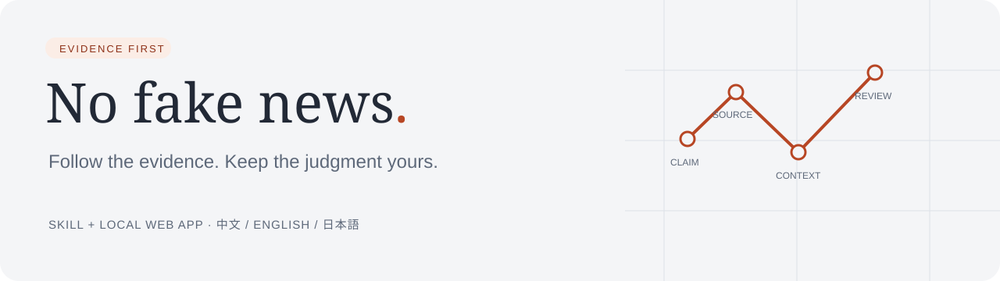
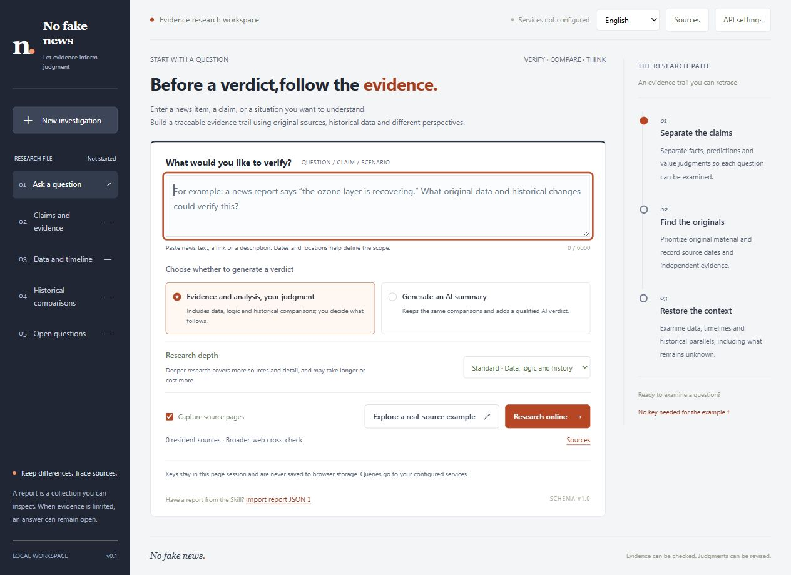
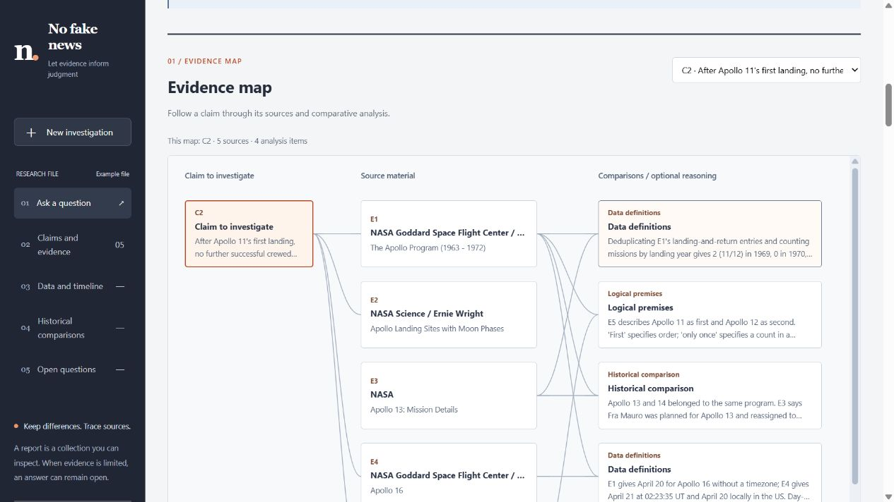
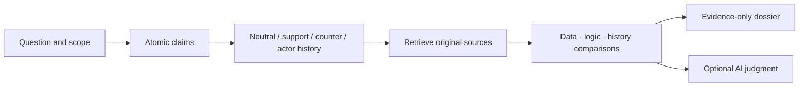

<p align="center"></p>
<p align="center"><a href="https://github.com/mengyihh233/No-fake-news/actions/workflows/ci.yml"></a> · <a href="LICENSE">MIT</a> · Python 3.11+ · No frontend build step</p>
<p align="center"><strong>English</strong> · <a href="README.zh-CN.md">简体中文</a> · <a href="README.ja.md">日本語</a></p>

# No fake news

Turn a claim, news story, question, or scenario into an inspectable evidence dossier. Compare original sources, data, logical premises, and historical cases—then choose whether AI should add a judgment.

Use the **local web app** with your own AI/search APIs, or install the **`tell-me-truth` Skill** in your AI host. The product is **No fake news**; the Skill ID stays `tell-me-truth` for compatibility.

> Fairness is a method, not a guarantee of absolute objectivity. Sources, search scope, assumptions, and uncertainty are exposed so readers can check the work.



## Features

| Capability | What it does |
| --- | --- |
| Optional judgment | Evidence only retains data, logic, and historical analysis; AI summary adds conditional judgments and explicit reasoning. |
| Adjustable depth | Brief / standard / deep change actual research budgets, independently of the judgment option. |
| Traceable evidence | Linked claims and sources, excerpts, lineage, charts and source tables, timelines, historical comparisons, unresolved questions. |
| Resident sources | Save up to six websites/document URLs. Supplement broad research or restrict search to those domains. |
| Authorized access | Session-only HTTP Basic credentials, Cookie, or Bearer token bound to an exact HTTPS origin. |
| Portable reports | JSON import/export and standalone HTML export with eligible local screenshots embedded. |
| Three languages | 简体中文 / English / 日本語 for UI, new narrative, export labels, CLI, Skill instructions, and documentation. Original excerpts stay unchanged. |
| Your own model | OpenAI-compatible Chat Completions plus a separate Tavily or Brave search account. |

Design rationale and diagram references: [Design notes](docs/DESIGN.md).



Select a claim, inspect a node, and follow its citations. Lines record relationships; they do not imply causation or a truth score. A text relationship table accompanies the diagram.

## Quick start

Requires **Python 3.11+**. Node.js is only needed for frontend tests.

```bash
git clone https://github.com/mengyihh233/No-fake-news.git
cd No-fake-news
python -m venv .venv
```

Activate with `source .venv/bin/activate` on macOS/Linux, or `.venv\Scripts\Activate.ps1` in PowerShell. Then:

```bash
python -m pip install -r requirements.txt
python app.py
```

Open **http://127.0.0.1:8000**. Select a language and load the evidence example without keys. The saved NASA example covers **Apollo, 1969–1972**, includes an actual source screenshot, and does not perform a fresh search. Multiple NASA pages form one source family, not five independent institutions. Offline examples are in [`examples/`](examples/).

The server accepts local connections only and has no user authentication or public-hosting setup. Change `TRUTH_PORT` if port 8000 is occupied.

## Configure services and sources

Open **API settings** and enter an AI Base URL, exact model ID, AI key, and a separate Tavily/Brave search key. A root such as `https://api.openai.com/v1` receives `/chat/completions`; a complete endpoint is also accepted. Explicit local compatible services may omit the AI key.

Only the **Chat Completions text protocol** is supported; the model must return requested JSON. Native Anthropic Messages/Gemini protocols need a compatible gateway. Failed provider calls show an error and never silently fall back to the demo.

Optional process variables: `TRUTH_AI_BASE_URL`, `TRUTH_AI_MODEL`, `TRUTH_AI_API_KEY`, `TAVILY_API_KEY`, `BRAVE_API_KEY`, `TRUTH_PORT`. [`.env.example`](.env.example) is a template; **`.env` is not automatically loaded**. Environment keys are not returned to the browser.

**Preferred sources:** the source manager saves nonsecret names/URLs. Balanced research also searches the broader web; preferred-only restricts source domains and discloses this scope. Being preferred does not make a source reliable.

**Website accounts:** HTTP Basic username/password, an existing Cookie session, or a Bearer token can authorize an exact HTTPS origin. Credentials remain session-only and are excluded from saved preferences, reports, browser storage, AI requests, and search requests. Arbitrary login forms, SSO, CAPTCHA, and MFA are not automatically handled; normal login sessions or site-specific integrations may be needed. Authenticated sources are not automatically screenshotted.

**Data flow:** queries go to search; your topic and retrieved text—including authorized account content—go to your AI provider; source sites receive retrieval requests. API keys and website credentials are used only for their corresponding requests. Choose providers appropriate for your content.

Credential fields are not sent as model/search configuration. Retrieved pages may contain usernames, email addresses or other personal data; known passwords and tokens are masked, but this is not general anonymization. Inspect reports before sharing.

## How research works



Evidence-only mode removes verdicts, summary, and evaluative reasoning **from responses and exports**, not just the screen. Both modes retain neutral comparative analysis. Models still select and organize material; this does not eliminate bias or bypass another service's rules.

Add a summary to an existing report without researching again; imported evidence is not reverified. Switching UI language does not translate existing report text or quotations. New research uses the selected language.

| Depth | Queries / sources / claims | Excerpt per source | Time limit |
| --- | --- | --- | --- |
| Brief | 4 / 6 / 4 | 1,800 characters | 150 s |
| Standard | 4 / 12 / 8 | 3,000 characters | 180 s |
| Deep | 8 / 24 / 12 | 4,500 characters | 360 s |

More depth may increase time and provider fees. Evidence standards are identical at every depth; inconclusive results are allowed. Capture attempts are limited to three public sources per investigation.

## Screenshots and offline reports

Optional automatic capture:

```bash
python -m pip install playwright
python -m playwright install chromium
```

Restricted capture disables scripts and external subresources; layout and passage visibility may differ. Gaps are recorded. Successful captures include source URL, actual capture time, and SHA-256. Screenshots and hashes do not certify truth. The curated NASA screenshot is an unmodified real-browser capture.

Web HTML export embeds eligible local screenshots up to 12 MB total; failed packaging retains links and explains the gap. The Skill's standard-library renderer also runs offline:

```bash
python skills/tell-me-truth/scripts/render_report.py examples/demo-report.en.json --output runtime/report.en.html --mode evidence-only --language en --capture-dir examples/captures
```

Use the matching JSON and `--language zh-CN` or `--language ja` for other labels. `--mode ai-summary` renders an existing summary and does not generate one.

## Install the Skill

```bash
python install_skill.py --language en
```

Installs under `$CODEX_HOME/skills/tell-me-truth` or `~/.codex/skills/tell-me-truth`, preserving existing files. Start a new chat or reload Skills, then:

```text
Use $tell-me-truth to investigate: <claim, news URL, or scenario>.
Scope: <time and place>. Language: English. Depth: deep.
Show evidence, data, logic, historical comparisons, and real source screenshots.
Leave the final judgment to me.
```

An AI summary is optional. Host tools determine Skill search/capture abilities; it does not automatically share web-app keys. See the [Skill entry](skills/tell-me-truth/SKILL.md) and its three-language reference documents.

## Development and limitations

```bash
python -m pytest tests -q
node --test tests/*.cjs
```

GitHub Actions tests Python and browser data. Coverage includes mode isolation, citations, missing/negative chart values, injection defenses, credential isolation, source scope, and multilingual output. Provider responses are mocked; tests do not certify a particular paid account.

Current boundaries: HTML/plain text retrieval, bounded research, no generic form login, complete PDF/audio/video extraction, streaming model output, native noncompatible model protocols, user authentication, or public deployment setup. Chart values must occur in cited excerpts; derived `count` calculations identify their entries. The web backend does not support other derived arithmetic yet. Grouping cannot detect every republication or conflict of interest. Inconsistency and historical analogy alone do not prove a present claim false. There is no calibrated “truth percentage.”

| Location | Purpose |
| --- | --- |
| `frontend/` | Three-language browser UI, no build step or frontend dependencies. |
| `truth_backend/`, `app.py` | Local API, providers, safe retrieval, validation, capture. |
| `skills/tell-me-truth/` | Skill, methods, report specification, offline renderer. |
| `examples/` | Three-language reports and attributed NASA source capture. |
| `tests/` | Backend, renderer, frontend-data, and release invariants. |

See [contributing](docs/CONTRIBUTING.md), [security](docs/SECURITY.md), and [third-party notices](NOTICE.md). Original code and documentation are [MIT licensed](LICENSE); third-party materials retain their own terms.
