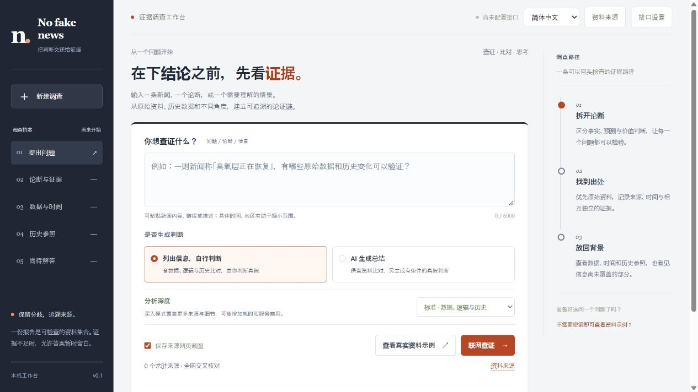
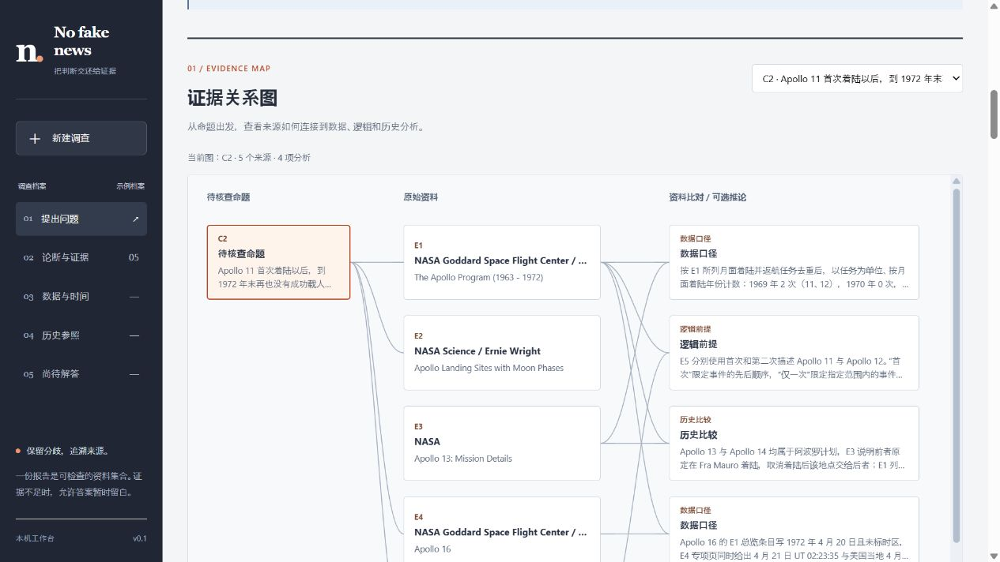
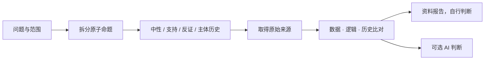

<p align="center"></p>
<p align="center"><a href="https://github.com/mengyihh233/No-fake-news/actions/workflows/ci.yml"></a> · <a href="LICENSE">MIT</a> · Python 3.11+ · 前端无需构建</p>
<p align="center"><a href="README.md">English</a> · <strong>简体中文</strong> · <a href="README.ja.md">日本語</a></p>

# No fake news

把论题、新闻、问题或情景变成可复核的证据档案。对照原始资料、数据、逻辑前提和历史案例，再由你选择是否让 AI 生成判断。

项目提供 **可接入自有 AI/搜索 API 的本机网页应用**和 **可安装的 `tell-me-truth` Skill**。项目及网页品牌为 **No fake news**；Skill 标识保留 `tell-me-truth`，便于继续使用。

> 公正是一套可检查的方法，不能靠“绝对客观”的承诺实现。项目公开来源、检索范围、假设和不确定性，让读者自行复核。



## 能做什么

| 能力 | 行为 |
| --- | --- |
| 自选是否判断 | 资料模式保留数据、逻辑、历史比对；AI 总结额外给出有条件的判断和显式论证。 |
| 自选分析深度 | 简要 / 标准 / 深入采用不同实际预算，与是否生成判断独立。 |
| 追溯证据 | 命题和来源关联、摘录、来源谱系、带出处的数据图表、时间线、历史参照及待解问题。 |
| 指定常驻资料 | 保存最多六个网站或资料 URL；可补充全网研究，也可限定指定域名。 |
| 访问授权网站 | 会话内提供精确 HTTPS 来源的 HTTP Basic 账号密码、Cookie 或 Bearer Token。 |
| 便携报告 | 导入/导出 JSON；导出可内嵌本机截图的独立 HTML。 |
| 完整三语 | 简体中文 / English / 日本語覆盖界面、新生成叙述、导出标签、命令提示、Skill 及文档；原始摘录保持原语言。 |
| 自接模型 | OpenAI 兼容 Chat Completions，加独立 Tavily 或 Brave 搜索账户。 |

布局、证据图与设计参考见[设计说明](docs/DESIGN.md)。



选择命题、点击节点，再沿引用核对原资料。连线只表示记录的关系，不代表因果或真值分数；图下另有文字关系表。

## 本机启动

需要 **Python 3.11+**；Node.js 仅用于前端测试。

```bash
git clone https://github.com/mengyihh233/No-fake-news.git
cd No-fake-news
python -m venv .venv
```

macOS/Linux 用 `source .venv/bin/activate` 激活；PowerShell 用 `.venv\Scripts\Activate.ps1`，然后运行：

```bash
python -m pip install -r requirements.txt
python app.py
```

打开 **http://127.0.0.1:8000**。选择语言，点击“查看真实资料示例”免密钥体验。保存的 NASA 示例限定 **1969—1972 年阿波罗计划**，包含原站实际截图；加载不会新搜索。多个 NASA 页面属于同一来源谱系，不能算五个独立机构。离线示例见 [`examples/`](examples/)。

服务只接受本机访问，没有用户认证或公开部署配置。端口冲突时设置 `TRUTH_PORT`。

## 接入服务及资料来源

打开“接口设置”，填写 AI Base URL、实际模型 ID、AI 密钥和独立的 Tavily/Brave 搜索密钥。`https://api.openai.com/v1` 等根地址会追加 `/chat/completions`，也接受完整接口地址。显式本机兼容服务可以不填 AI 密钥。

只支持 **Chat Completions 文本协议**，模型须按要求返回 JSON。Anthropic 原生 Messages、Gemini 原生协议需兼容网关。请求失败明确报错，不会偷偷用演示结果替代研究。

可选进程变量为 `TRUTH_AI_BASE_URL`、`TRUTH_AI_MODEL`、`TRUTH_AI_API_KEY`、`TAVILY_API_KEY`、`BRAVE_API_KEY`、`TRUTH_PORT`。[`.env.example`](.env.example) 仅为模板，**程序不自动读取 `.env`**。环境密钥不回传浏览器。

**常驻来源：**来源管理器保存非秘密名称和 URL。全网交叉核对还会查询更广网络；仅指定来源会限定域名并披露范围。常驻来源不会自动成为可信来源。

**网站账户：**支持 HTTP Basic 账号密码、已有 Cookie 会话或 Bearer Token，精确绑定 HTTPS 来源，仅会话内保留。凭据不写入常驻设置、报告、浏览器存储，也不发给 AI 或搜索服务。不能通用处理登录表单、SSO、验证码及多因素验证；需要正常登录会话或站点适配。账户来源不自动截图。

**隐私流向：**查询发给搜索服务；主题和取得的正文（包括授权账户内容）发给所配 AI；来源站收到抓取请求。API 密钥及网站凭据仅用于对应请求。请根据内容选择服务。

凭据字段不会作为模型或搜索配置发送。网站正文可能包含用户名、邮箱等个人信息；系统遮盖已知密码和令牌，不提供通用匿名化保证。分享报告前请检查内容。

## 研究流程



资料模式会从**响应和导出**删除裁决、总结及评判性推论，而非只隐藏界面。两模式均保留中性比对分析。模型仍参与选择和整理，不能消除全部偏差或承诺绕过其他服务规则。

已有报告可追加总结而不重新研究；不会重新核实导入材料。切换界面语言不会翻译已有正文或原始引文，新研究使用所选语言。

| 深度 | 查询 / 来源 / 命题上限 | 每源摘录 | 时限 |
| --- | --- | --- | --- |
| 简要 | 4 / 6 / 4 | 1,800 字符 | 150 秒 |
| 标准 | 4 / 12 / 8 | 3,000 字符 | 180 秒 |
| 深入 | 8 / 24 / 12 | 4,500 字符 | 360 秒 |

深入可能增加耗时和供应商费用。所有深度采用相同证据标准，都允许证据不足。每次最多尝试三个公开来源截图。

## 真实截图与离线报告

自动截图为可选能力：

```bash
python -m pip install playwright
python -m playwright install chromium
```

自动捕获禁用脚本及外部子资源，布局或目标段落可见性可能不同，缺口会记录。成功截图包含原 URL、真实时间和 SHA-256。截图及哈希不能认证真假。预置 NASA 原图由真实浏览器取得且未修改。

HTML 导出可内嵌符合要求的本机截图，合计最多 12 MB；失败保留链接并注明。Skill 的标准库渲染器也能离线使用：

```bash
python skills/tell-me-truth/scripts/render_report.py examples/demo-report.json --output runtime/report.zh-CN.html --mode evidence-only --language zh-CN --capture-dir examples/captures
```

可改为 `--language en` / `--language ja` 及对应 JSON。`--mode ai-summary` 只渲染已有总结，不生成判断。

## 安装 Skill

```bash
python install_skill.py --language zh-CN
```

安装到 `$CODEX_HOME/skills/tell-me-truth`，未设置时为 `~/.codex/skills/tell-me-truth`；已有文件不覆盖。新建聊天或重新加载 Skills 后：

```text
使用 $tell-me-truth 查证：<论题、新闻网址或情景>。
范围：<时间、地区>。语言：简体中文。深度：深入。
展示证据、数据、逻辑、历史比对及真实来源截图，由我自行判断。
```

也可要求 AI 总结。Skill 依赖宿主实际可用的联网/截图工具，不自动共享网页密钥。参见 [Skill 入口](skills/tell-me-truth/SKILL.md) 及三语参考文档。

## 开发与边界

```bash
python -m pytest tests -q
node --test tests/*.cjs
```

GitHub Actions 运行 Python 与前端数据测试，覆盖模式隔离、引用、缺失/负数、注入防护、凭据隔离、来源范围和多语言输出。供应商响应使用模拟数据，通过测试不等于已验证某付费账户。

当前支持 HTML/纯文本及有限预算研究，不支持通用表单登录、完整 PDF/音视频提取、流式模型输出、原生非兼容协议、用户认证或公开部署配置。图表数字须在所引摘录中；派生 `count` 计数须指出条目，网页后端暂不支持其他派生运算。归组不能识别全部转载及利益关系。前后矛盾、历史类比不能单独证明当前命题为假。没有校准后的“真实性百分比”。

| 目录 | 内容 |
| --- | --- |
| `frontend/` | 三语网页，无构建步骤及外部前端依赖。 |
| `truth_backend/`、`app.py` | 本机 API、供应商、安全抓取、验证及截图。 |
| `skills/tell-me-truth/` | Skill、方法、报告格式、离线渲染器。 |
| `examples/` | 三语报告及注明出处的 NASA 原图。 |
| `tests/` | 后端、渲染器、前端数据及发布约束测试。 |

参见[贡献说明](docs/CONTRIBUTING.md)、[安全说明](docs/SECURITY.md)及[第三方材料说明](NOTICE.md)。原创代码与文档采用 [MIT](LICENSE)，第三方材料保留自身条款。
